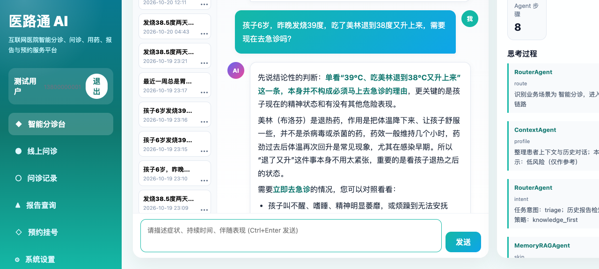
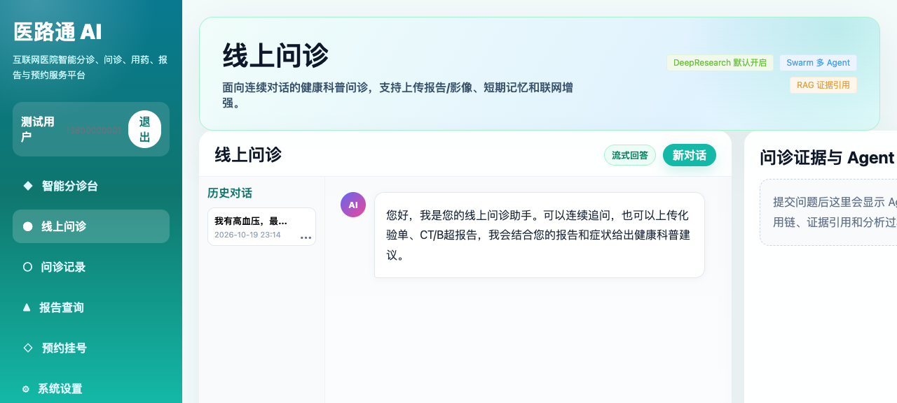
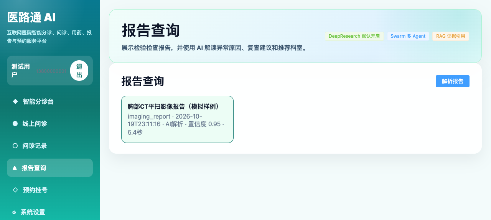
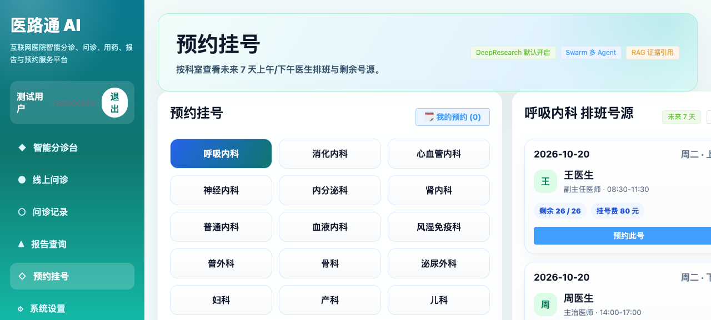
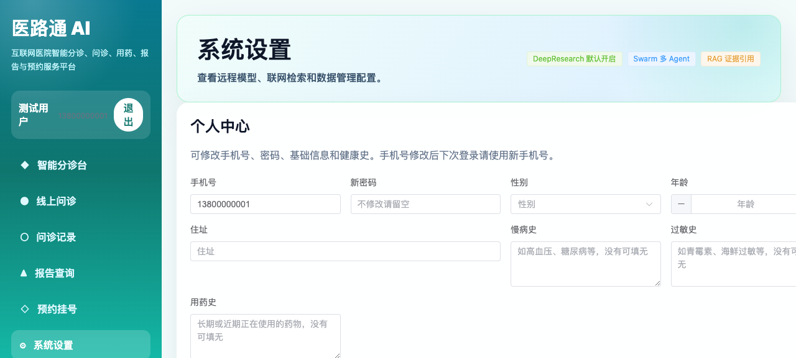
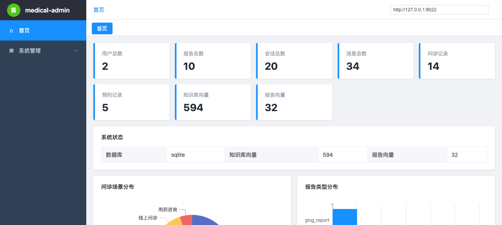

# 医路通 AI · 智能分诊与就医服务平台

> FastAPI + Vue3 + Chroma + 多 Agent 编排的互联网医院场景 AI 应用：智能分诊、线上问诊、用药咨询、报告解读、预约挂号，外加一套独立的管理后台。

系统围绕「患者描述症状 → 输出风险分层、推荐科室、可追溯的循证依据」这条主线设计，所有结论都带 RAG 证据与 Agent 推理链路，不以黑盒方式给建议。

---

## 界面预览

| 智能分诊台 | 线上问诊 |
|---|---|
|  |  |

| 报告查询 | 预约挂号 |
|---|---|
|  |  |

| 系统设置 | 管理后台 |
|---|---|
|  |  |

---

## 核心能力

**患者端（用户前台）**

- **智能分诊**：输入症状、持续时间、伴随表现，输出风险分层（低/中/高危）、建议挂号科室、就诊紧迫度判断
- **线上问诊**：支持多轮追问，可上传化验单、CT/B 超报告，结合上下文给出健康科普建议
- **用药咨询**：合并用药、禁忌、剂量与服用时间的合规提示
- **报告查询**：上传 PDF/图片报告，视觉模型解析结构化指标，给出异常原因解读与复查建议
- **预约挂号**：按科室查看未来 7 天医生排班与剩余号源

**管理端**

- 用户、报告、会话、消息、问诊记录、预约记录的总览统计
- 知识库向量与报告向量的索引状态
- 问诊场景分布、报告类型分布可视化

---

## 架构

```
Vue3 (5178)  ──HTTP/SSE──▶  FastAPI (8012)
                                 │
                    ┌────────────┼─────────────┐
                    ▼            ▼             ▼
              MedicalSwarm   Chroma RAG   VLM 报告解析
             (8 个 Agent)   (594 chunks)   (图片→结构化)
                    │
                    ▼
            云端 LLM（OpenAI 兼容接口）+ 本地 Embedding（Qwen3-Embedding-0.6B，CPU）

管理后台：FastAPI (8022) + 静态页，独立进程，读同一个 SQLite
```

**8 个 Agent 分工**

| Agent | 职责 |
|---|---|
| `RouterAgent` | 判断场景意图（分诊 / 问诊 / 用药 / 报告）与检索策略 |
| `ContextAgent` | 整理患者画像、历史对话、本次症状要点 |
| `MemoryRAGAgent` | 短期会话记忆 + 长期健康档案召回 |
| `RAGAgent` | 知识库向量检索，产出带分数的证据片段 |
| `AttachmentAgent` | 解析上传的报告 / 化验单，抽取指标 |
| `ResearchAgent` | 联网检索增强（可降级为纯本地知识库） |
| `ReasoningAgent` | 综合证据生成结论，输出 `<meta>` 结构化字段 |
| `SafetyAgent` | 合规兜底：禁止确诊、禁止处方、高危症状强制提示急诊 |

流式链路使用 SSE，前端逐字渲染，同时把每个 Agent 的 `trace` 事件推到右侧「思考过程」面板，做到过程可解释。

---

## 技术栈

| 层 | 选型 |
|---|---|
| 后端 | FastAPI、Pydantic、httpx、uvicorn |
| 前端 | Vue 3、Vite、原生 SSE 解析（`fetch` + `ReadableStream`） |
| 检索 | Chroma 持久化向量库、Qwen3-Embedding-0.6B（本地 CPU，1024 维） |
| 生成 | 任意 OpenAI 兼容接口的大模型（默认 DeepSeek） |
| 文档解析 | PyMuPDF、python-docx、openpyxl、Pillow |
| 存储 | SQLite（用户、会话、消息、报告、预约） |

---

## 快速开始

```bash
# 1. 后端依赖
cd backend
python3 -m venv .venv && .venv/bin/pip install -r requirements.txt

# 2. 配置
cp .env.example .env          # 填入大模型 API Key、管理员密码、JWT 密钥
cp config.example.yaml config/config.yaml

# 3. 启动
cd ..
./backend/.venv/bin/python backend/scripts/service_ctl.py start
```

| 服务 | 地址 |
|---|---|
| 用户端 | http://127.0.0.1:5178 |
| 后端 API | http://127.0.0.1:8012/docs |
| 管理后台 | http://127.0.0.1:8022 |

管理后台账号在 `.env` 的 `MEDIX_ADMIN_USERNAME` / `MEDIX_ADMIN_PASSWORD` 中配置，请勿使用默认值部署。

> 若替换了 Embedding 模型，必须重建向量库：`backend/scripts/rebuild_kb_local.py`。向量库存的是坐标，换模型等于换尺子，旧索引会失效且不会报错，只会静默降低召回质量。

---

## 目录结构

```text
医路通Agent_Pro/
├── backend/
│   ├── app/
│   │   ├── api/            # auth / platform / chat / upload
│   │   ├── core/           # 配置、鉴权、数据库
│   │   └── services/       # llm / vlm / chroma_rag / medical_business
│   ├── config.example.yaml
│   ├── .env.example
│   └── requirements.txt
├── frontend/               # Vue3 患者端
├── admin_system/           # 管理后台（后端 + 静态前端）
├── data/
│   ├── knowledge_base/     # 37 篇医学知识（Markdown 原文）
│   └── chroma/             # 向量库（不随仓库分发）
├── screenshots/
└── docs/
```

`data/chroma/`、`backend/models/`、`data/runtime/`、`data/uploads/` 均不入库：前者体积大且与模型强绑定，后两者包含用户真实数据。

---

## 免责声明

本项目为技术演示与工程实践项目，输出内容仅供健康科普参考，不构成诊断、处方或治疗建议。任何身体不适请及时前往正规医疗机构就诊。
